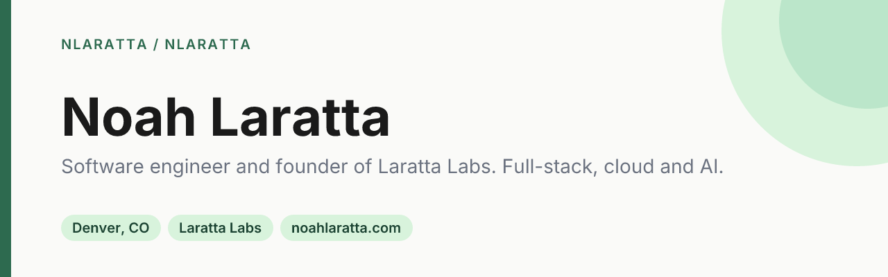
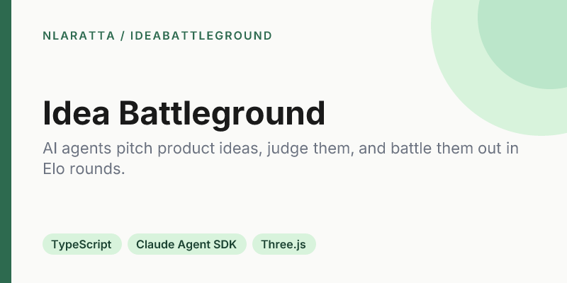
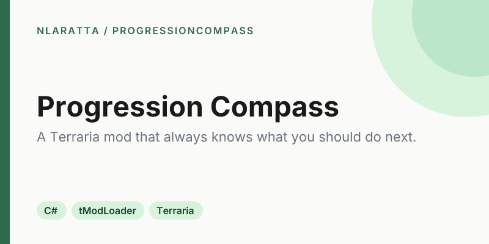
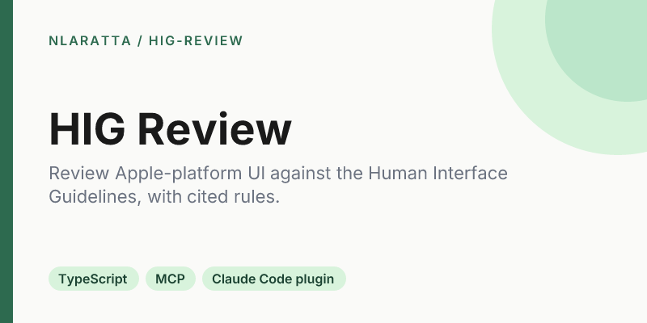
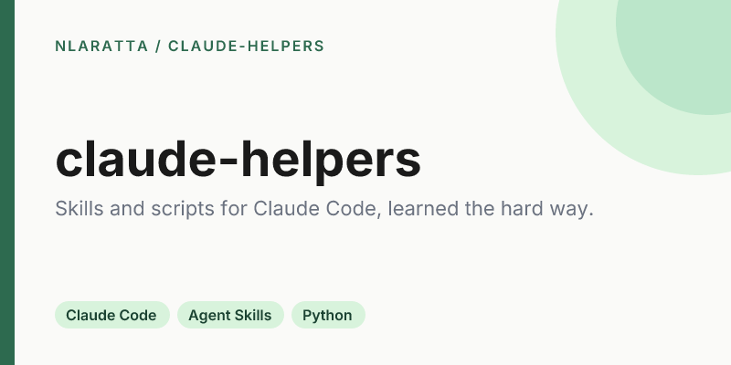

  

I'm a software engineer in Denver and the founder of [Laratta Labs](https://larattalabs.com), an AI-native software studio. I work across full-stack apps, cloud infrastructure and AI, and I also do engineering for PSIA-AASI. Before that I was at Lockheed Martin. I studied CS at MSU Denver.

**[noahlaratta.com](https://noahlaratta.com)** · Studio work lives at **[github.com/larattalabs](https://github.com/larattalabs)**

<!-- projects:start -->
## Featured

<table>
  <tr>
    <td width="50%" valign="top">
      
      
<a href="https://github.com/nlaratta/IdeaBattleGround">Code</a>

    </td>
    <td width="50%" valign="top">
      
      
<a href="https://github.com/nlaratta/ProgressionCompass">Code</a>

    </td>
  </tr>
  <tr>
    <td width="50%" valign="top">
      
      
<a href="https://github.com/nlaratta/hig-review">Code</a>

    </td>
    <td width="50%" valign="top">
      
      
<a href="https://github.com/nlaratta/claude-helpers">Code</a>

    </td>
  </tr>
</table>

## Shipped at Laratta Labs

- **SquadUp**: Social fitness platform: find local workouts, train together, and let hosts get paid. [App Store](https://apps.apple.com/us/app/squadup-lift-more-together/id6745851197) · [supsquadup.com](https://supsquadup.com)
- **YardPaint**: Photograph your yard, paint zones, and get a photorealistic landscaped preview with the plants to match. [App Store](https://apps.apple.com/us/app/yardpaint/id6781556965) · [yardpaint.app](https://yardpaint.app)

Open source from the studio:

- [**Architect**](https://github.com/larattalabs/architect-mc): Minecraft mod where Claude designs buildings as parametric code you place in your world.
- [**Local Lab**](https://github.com/larattalabs/local-lab): Desktop playground for comparing local AI models on Apple Silicon side by side.
- [**Hunyuan3D for Blender on Mac**](https://github.com/larattalabs/blender-hunyuan3d-mac): Textured 3D asset generation inside Blender, entirely on Apple Silicon.
- [**Lab UI**](https://github.com/larattalabs/lab-ui): Shared Fabric client UI library for the studio's Minecraft mods.

## All projects

**AI & developer tools**

| Project | What it is | Stack |
|---|---|---|
| [**Idea Battleground**](https://github.com/nlaratta/IdeaBattleGround) | AI agents pitch product ideas, judge them, and battle them out in Elo rounds. | TypeScript, Claude Agent SDK, Three.js |
| [**HIG Review**](https://github.com/nlaratta/hig-review) | Review Apple-platform UI against the Human Interface Guidelines, with cited rules. | TypeScript, MCP, Claude Code plugin |
| [**claude-helpers**](https://github.com/nlaratta/claude-helpers) | Skills and scripts for Claude Code, learned the hard way. | Claude Code, Agent Skills, Python |
| [**Study Guide Generator**](https://github.com/nlaratta/study-guide-generator) | Personalized, step-by-step study plans for any subject. | Flask, OpenAI, JavaScript |

**Games & mods**

| Project | What it is | Stack |
|---|---|---|
| [**Progression Compass**](https://github.com/nlaratta/ProgressionCompass) | A Terraria mod that always knows what you should do next. | C#, tModLoader, Terraria |
| [**Game Hub**](https://github.com/nlaratta/game-hub) · [live](https://nlaratta.github.io/game-hub/) | One page to play my small browser games. | HTML, CSS, GitHub Pages |
| [**Freakmoji Clicker**](https://github.com/nlaratta/emoji-clicker) · [live](https://nlaratta.github.io/emoji-clicker/) | Click the emoji, buy upgrades, chase a high score. | JavaScript, HTML, CSS |
| [**Wordle Solver**](https://github.com/nlaratta/wordle-solver) | Solves a Wordle puzzle by filtering on green, yellow and gray feedback. | Java, CLI |

**Web, data & trading**

| Project | What it is | Stack |
|---|---|---|
| [**noahlaratta.com**](https://github.com/nlaratta/noahlaratta) · [live](https://noahlaratta.com) | My personal site: projects, experience, and lab write-ups. | Next.js, TypeScript, Tailwind, MDX |
| [**db-tinkering**](https://github.com/nlaratta/db-tinkering) | SQL and reporting practice on the Open Media Database. | PostgreSQL, Tableau, SQL |
| [**Indicator Bot**](https://github.com/nlaratta/indicator-bot) | A KuCoin swing-trading bot driven by MACD crossovers. | Python, pandas, KuCoin API |
<!-- projects:end -->

Every repo here follows the same [standards](STANDARDS.md). Banners, cards and this list are generated from [`brand/`](brand/).
