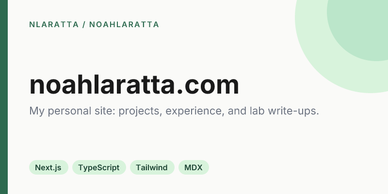
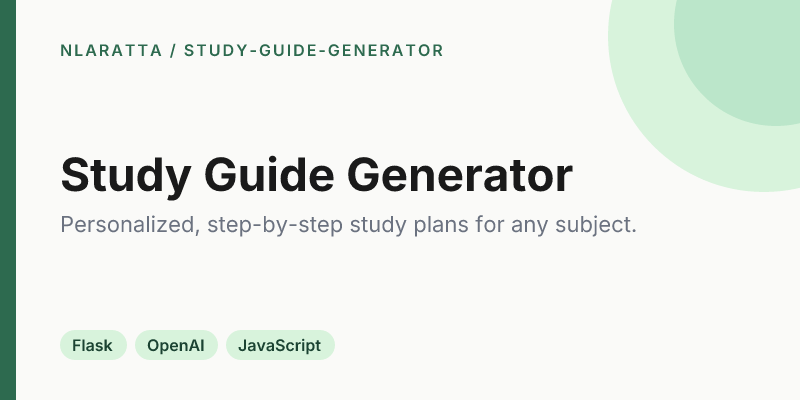
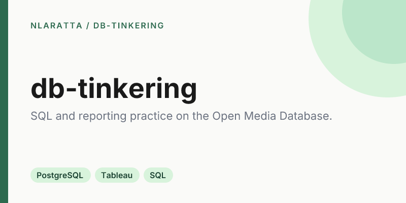
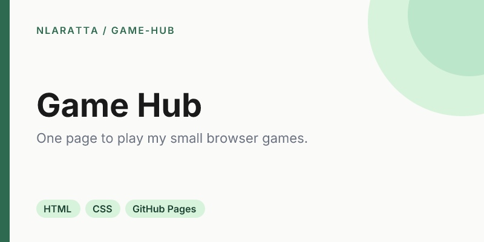
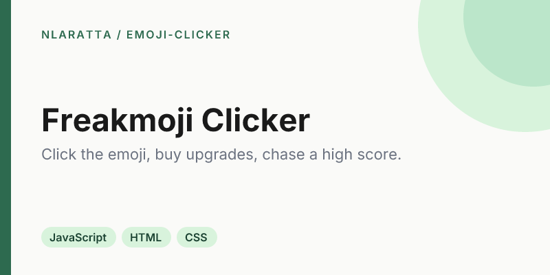
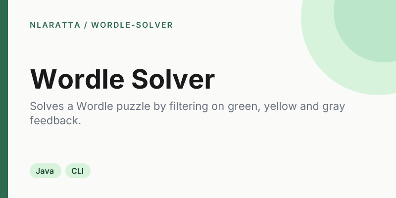
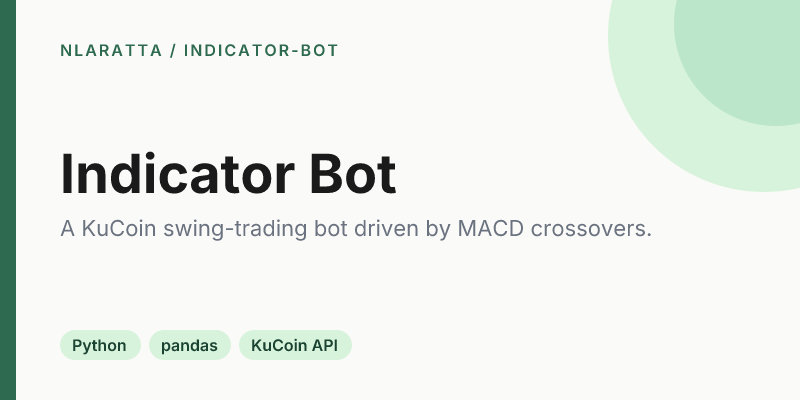

  

I'm a software engineer in Denver and the founder of [Laratta Labs](https://larattalabs.com), an AI-native software studio. I work across full-stack apps, cloud infrastructure and AI, and I also do engineering for PSIA-AASI. Before that I was at Lockheed Martin. I studied CS at MSU Denver.

**[noahlaratta.com](https://noahlaratta.com)** · Studio work lives at **[github.com/larattalabs](https://github.com/larattalabs)**

## Projects

<table>
  <tr>
    <td width="50%" valign="top">
      
      
<a href="https://noahlaratta.com">Site</a> · <a href="https://github.com/nlaratta/noahlaratta">Code</a>

    </td>
    <td width="50%" valign="top">
      
      
<a href="https://github.com/nlaratta/claude-helpers">Code</a>

    </td>
  </tr>
  <tr>
    <td width="50%" valign="top">
      
      
<a href="https://github.com/nlaratta/study-guide-generator">Code</a>

    </td>
    <td width="50%" valign="top">
      
      
<a href="https://github.com/nlaratta/db-tinkering">Code</a>

    </td>
  </tr>
  <tr>
    <td width="50%" valign="top">
      
      
<a href="https://nlaratta.github.io/game-hub/">Play</a> · <a href="https://github.com/nlaratta/game-hub">Code</a>

    </td>
    <td width="50%" valign="top">
      
      
<a href="https://nlaratta.github.io/emoji-clicker/">Play</a> · <a href="https://github.com/nlaratta/emoji-clicker">Code</a>

    </td>
  </tr>
  <tr>
    <td width="50%" valign="top">
      
      
<a href="https://github.com/nlaratta/wordle-solver">Code</a>

    </td>
    <td width="50%" valign="top">
      
      
<a href="https://github.com/nlaratta/indicator-bot">Code</a>

    </td>
  </tr>
</table>

Every repo here follows the same [standards](STANDARDS.md), and its banners are generated from [`brand/`](brand/).
